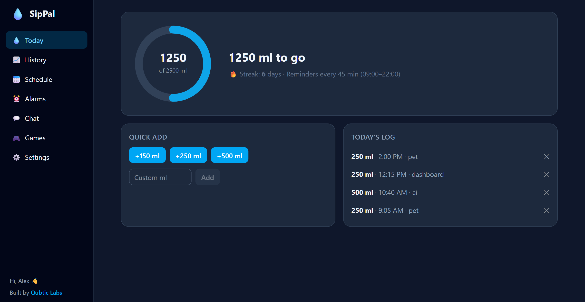
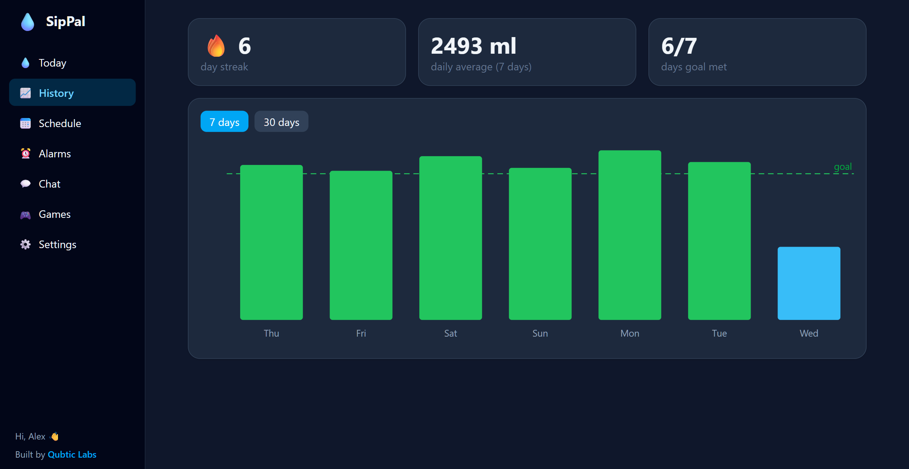
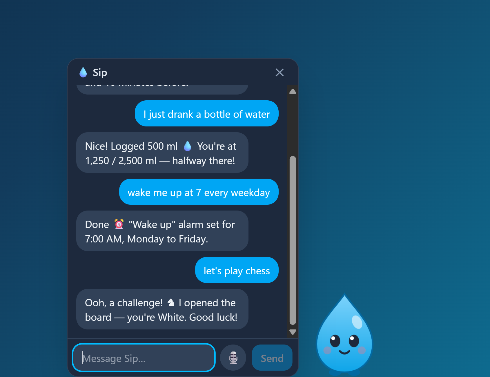
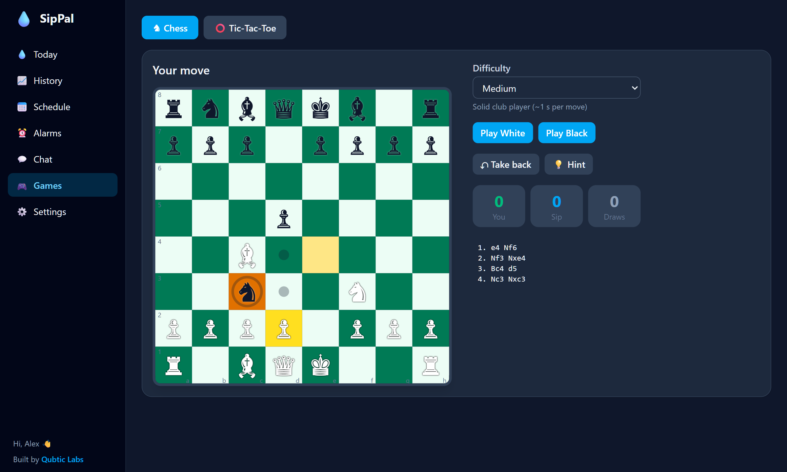
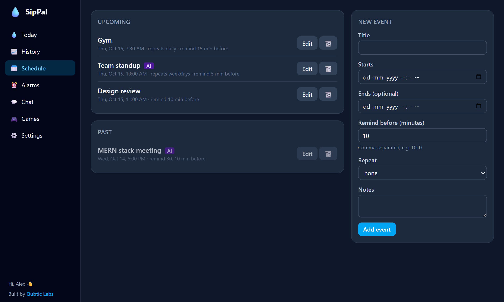
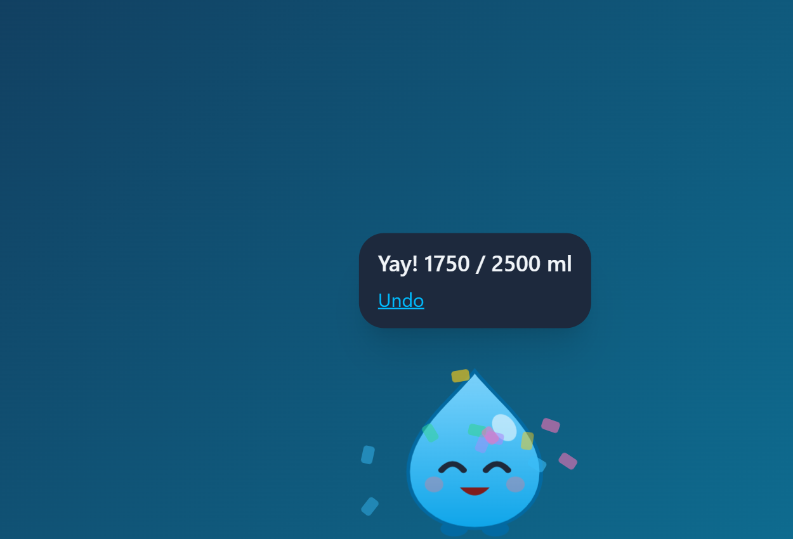

<div align="center">

<a href="https://www.qubticlabs.studio/"></a>

[](https://github.com/Anir6800/sippal/releases/latest)
[](https://github.com/Anir6800/sippal/releases/latest)
[](https://www.electronjs.org/)
[](https://www.qubticlabs.studio/)

**Built by [Qubtic Labs](https://www.qubticlabs.studio/) — *Intelligence amplified by design.***

</div>

## Meet Sip

<p align="center"></p>

## Screenshots

| Today | History |
| --- | --- |
|  |  |
| **Chat with Sip** | **Play chess** |
|  |  |
| **Schedule** | **Celebrate** |
|  |  |

## Download

<p align="center"><a href="https://github.com/Anir6800/sippal/releases/latest"></a></p>

| Platform | File | First launch |
| --- | --- | --- |
| **Windows 10/11** | `SipPal-Setup-x.y.z.exe` | SmartScreen may warn: **More info → Run anyway** |
| **macOS** (Apple Silicon) | `SipPal-x.y.z-mac-arm64.dmg` | Drag to Applications, then **right-click → Open** once |
| **macOS** (Intel) | `SipPal-x.y.z-mac-x64.dmg` | Same as above |
| **Linux** | `SipPal-x.y.z-linux-x86_64.AppImage` | `chmod +x SipPal-*.AppImage` then run it |

The builds aren't code-signed yet, which is why each OS asks once. If macOS says the app "is damaged", run `xattr -cr /Applications/SipPal.app`.
Full-screen and Zoom-meeting detection is Windows-only; everything else works on all three.

## Features

- **Desktop pet overlay.** Sip lives in a transparent, click-through, always-on-top overlay. It breathes, blinks, wanders along the bottom of the screen, sleeps (Zzz) during quiet hours or when you're away, and can be dragged around (it dangles, then drops and squishes).
- **Water reminders.** When a reminder is due, Sip gets thirsty: it holds up a glass, bounces, walks toward your cursor and offers `+150 / +250 / +500 ml` and `Snooze 10m` buttons. If you ignore it, it escalates (bigger bounce, then shaking) up to a capped level. Logging water makes it celebrate with confetti, and reaching the daily goal gets a special animation.
- **Pet interactions.** Click to chat, double-click to log your default cup, right-click for a menu.
- **Water tracking.** Manual or weight-based goal, cup presets, reminder interval, active hours, snooze, a custom day-reset hour (for night owls), undo, streaks, and 7/30-day history charts.
- **Alarms.** Once, daily, weekdays, weekends or custom days, with four synthesised sounds or the system sound, and snooze. When an alarm rings, the pet holds a sign and the notification has Dismiss/Snooze buttons.
- **Schedule.** Events with multiple reminders (e.g. 10 min before plus at the start) and daily, weekly or weekday recurrence.
- **Missed reminders.** After sleep or a restart you get a single "You missed…" summary instead of a burst of alarms.
- **Gemini assistant.** Uses function calling with 13 tools. Say "set a MERN stack meeting at 6", "move it to 7:30", "cancel all meetings on Friday" (deletes ask you to confirm first), "I drank a bottle of water" or "wake me up at 7 every weekday". Push-to-talk voice input and optional text-to-speech replies are included.
- **Games.** Play **chess** and **tic-tac-toe** against Sip in the Games tab, or just say "let's play chess".
  - Chess uses a built-in engine: alpha-beta search with quiescence and iterative deepening, ~1.6M positions/s. It has 3 difficulty levels, take-back, hints and a move list, and its move generation is perft-verified.
  - Tic-tac-toe on Hard plays perfect minimax and can't be beaten.
  - Sip reacts to every result.
- **Stays out of the way.** The pet hides during full-screen apps, presentations and Zoom meetings. It lives in the system tray (with a pause-reminders option), auto-launch at login is optional, and it has light/dark themes.
- **Your data stays local.** Everything is stored in SQLite, with JSON export/import and reset. The app works fully offline except for chat.

## Setup

Requires Node.js 22+ and Windows 10/11. macOS and Linux build too, but full-screen detection is Windows-only.

```bash
npm install
npm run dev
```

### Getting a Gemini API key

1. Go to https://aistudio.google.com/apikey and sign in with a Google account.
2. Click **Create API key** and copy it.
3. In SipPal open **Dashboard → Settings → AI assistant**, paste it, click **Save key**, then **Test key**.

The key is encrypted with your OS account (Electron `safeStorage` / DPAPI). It stays in the main process and is never sent to the UI or written to logs. The model defaults to `gemini-3.8-flash`, and you can change it in Settings.

## Commands

| Command | What it does |
| --- | --- |
| `npm run dev` | Run with hot reload |
| `npm test` | Vitest: scheduler math (incl. DST), date parsing, water math, tool handlers, AI loop, pet FSM |
| `npm run typecheck` | TypeScript |
| `npm run build` | Production bundles into `out/` |
| `npm run dist` | Windows NSIS installer into `dist/` |
| `npm run dist:mac` / `dist:linux` | Other platforms |
| `npm run icon` | Regenerate `resources/icon.png` (drawn in code) |

`.env.example` lists the dev-only variables (e.g. `SIPPAL_DEVTOOLS=1`).

## Architecture

```
src/main      Electron main process: windows, tray, IPC, SQLite, scheduler, Gemini
  ai/         prompt (rebuilt every request), tools (zod → JSON schema + validation), loop
  services/   settings, water, events, alarms, chat, data (export/import)
  bus.ts      central event bus: every change → scheduler replans + all windows refetch
src/preload   minimal typed contextBridge API (invoke + event streams)
src/renderer
  pet/        FSM (pure), physics loop, droplet SVG renderer, bubbles, WebAudio sounds
  dashboard/  Today / History / Schedule / Alarms / Chat / Settings
  common/     zustand store, shared ChatView, voice capture
src/shared    types, zod schemas, IPC contract, time & schedule math (tested)
tests/        Vitest
```

- **Security.** Windows run with `contextIsolation`, `sandbox`, no `nodeIntegration`, a CSP, blocked navigation, and only the microphone permission. Every IPC payload and every Gemini tool argument is validated with zod before anything touches the DB.
- **Scheduling.** node-schedule runs in the main process only. There is one job per item pointing at its next fire time, and all jobs are replanned on any change and on resume.
- **Swapping in sprite sheets.** Write a component with the `PetRendererProps` contract (`pet/DropletRenderer.tsx`) and assign it to `Renderer` in `pet/Pet.tsx`.

See [PLAN.md](PLAN.md) for milestones and [DECISIONS.md](DECISIONS.md) for the reasoning behind the design choices.

---

<div align="center">

Made with 💙 by **[Qubtic Labs](https://www.qubticlabs.studio/)** · AI products, consulting & production systems

</div>
